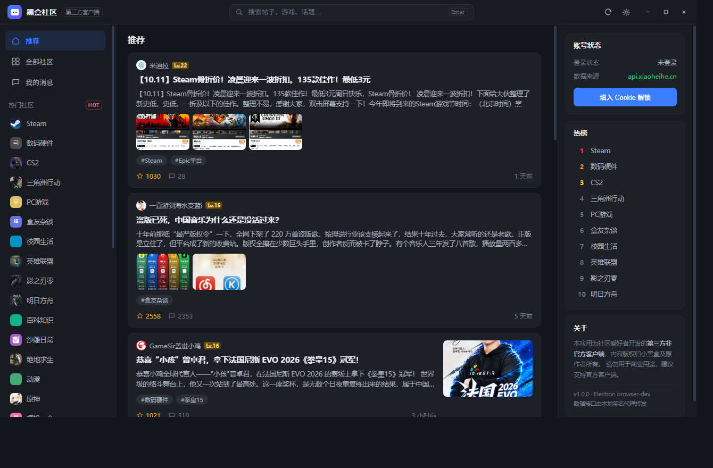

# 黑盒社区 · 第三方桌面客户端

基于 Electron 构建的小黑盒社区（xiaoheihe.cn）第三方桌面客户端，界面参考官方 Web 端信息流布局，数据全部来自小黑盒公开接口。

> ⚠️ 本项目为社区爱好者学习交流作品，**非官方应用**。所有内容版权归小黑盒及原作者所有，请勿用于商业用途。

---

## 功能

| 模块 | 说明 |
| --- | --- |
| 推荐信息流 | 无限滚动加载官方推荐流，展示作者/等级/配图/点赞/评论数 |
| 热门社区 | 侧栏 74 个热门板块一键切换 |
| 板块帖子 | 支持按板块浏览帖子列表 |
| **扫码登录** | 调用官方二维码接口，App 扫码即可登录，自动保存登录态 |
| 搜索 | 关键词搜索帖子与话题（需登录） |
| 帖子详情 | 正文 + 评论树（需登录） |
| 我的消息 | 回复/点赞/系统通知（需登录） |
| Cookie 登录 | 扫码之外的备用方式，本机保存 |

## 扫码登录原理

调用小黑盒官方 Web 端正在使用的二维码登录接口（无需逆向加密，直接复用公开流程）：

```
1. GET /account/get_qrcode_url/?app=web   -> { qr_url, expire: 120 }
   qr_url = https://api.xiaoheihe.cn/account/qr_login/?qr=<uuid>&app=web
   （已用 DevTools 抓包核对：与官方网页版登录生成的 qr_url 完全一致）
2. 将 qr_url 生成为二维码图片展示（margin=4 保证静区，手机可稳定识别）
3. GET /account/qr_state/?qr=<uuid>&app=web -> result.error:
      wait   待扫码
      ready  已扫码，待手机确认
      ok     登录成功（返回 heybox_id / pkey / 用户资料）
      其他   已失效
4. 成功后按官方 e6e() 的口径组装 Cookie
   （heybox_id / user_heybox_id / pkey / user_pkey + 会话期间服务端下发的 Set-Cookie）并落盘
5. 立即调用 /account/restore_login 校验登录态并拉取资料，失败原因会显示在界面上
```

登录态轮询间隔 1.8s，二维码有效期 120s，过期后可一键刷新。网络抖动时自动重试（连续约 15 秒失败才提示）。


## 技术要点

- **请求签名**：小黑盒所有接口都要求 `hkey` 签名。本项目复现了 Web 端算法
  （字符集映射 → 交错混合 → MD5 → 前缀映射 + Rijndael 校验位），
  仅依赖 Node 内置 `crypto`，**零第三方依赖**。
  已知测试向量：`/account/data_report_web/` + `1770529394` + `3D6891C5...` → `3XX1P62` ✅
- **安全隔离**：渲染进程 `contextIsolation` 开启、`nodeIntegration` 关闭，
  签名逻辑与 Cookie 全部留在主进程，页面通过受限 IPC 调用。
- **图片防盗链**：注册自定义 `hbimg://` 协议，在主进程带 `Referer` 拉取图片后回传，
  并做域名白名单（仅 `*.xiaoheihe.cn` / `*.max-c.com`）。

## 目录结构

```
├── main.js              # Electron 主进程：窗口、IPC、图片代理、配置持久化
├── preload.js           # contextBridge 安全桥
├── src/
│   ├── hkey.js          # 请求签名算法
│   └── heybox.js        # 小黑盒 API 客户端
├── renderer/
│   ├── index.html       # 界面骨架
│   ├── style.css        # 深色主题样式
│   └── app.js           # 视图路由与渲染
└── test/
    └── client-test.js   # 接口链路自检
```

## 运行

```bash
npm install       # 安装依赖（首次会下载 Electron 运行时）
npm start         # 启动桌面应用
npm run dev       # 启动并打开开发者工具
npm run web       # 浏览器预览模式（无需 Electron，http://127.0.0.1:5173）
```



> 浏览器预览模式与桌面版共用同一套界面和 API 封装（`renderer/shim.js` 自动切换），
> 适合不装 Electron 快速预览 UI。桌面版功能以 `npm start` 为准。

## 打包

```bash
npm run build     # 生成 Windows 安装包，输出到 dist/
```

产物：

| 文件 | 说明 |
| --- | --- |
| `dist/黑盒社区 Setup 1.0.0.exe` | NSIS 安装包（约 79 MB），可选安装目录 |
| `dist/win-unpacked/黑盒社区.exe` | 免安装绿色版，直接双击运行 |

打包注意事项（Windows）：
- `winCodeSign` 缓存解压含 macOS 符号链接，**无管理员权限/未开开发者模式时可能失败**。
  解决办法是预先手动解压跳过 `darwin`/`linux` 目录：
  ```bash
  node_modules/7zip-bin/win/x64/7za.exe x \
    "$LOCALAPPDATA/electron-builder/Cache/winCodeSign/<临时名>.7z" \
    -o"$LOCALAPPDATA/electron-builder/Cache/winCodeSign/winCodeSign-2.6.0" \
    -xr'!darwin' -xr'!linux'
  ```
- 国内网络建议设置镜像：
  ```bash
  export ELECTRON_MIRROR="https://npmmirror.com/mirrors/electron/"
  export ELECTRON_BUILDER_BINARIES_MIRROR="https://npmmirror.com/mirrors/electron-builder-binaries/"
  ```
- 未做代码签名，首次运行可能触发 Windows SmartScreen 提示，点「仍要运行」即可。

## 登录说明

未登录时：推荐流、板块、帖子列表可正常浏览；
帖子详情 / 评论 / 搜索 / 消息会返回登录校验（`show_captcha` / `login`）。

解锁方式：浏览器登录 [xiaoheihe.cn](https://xiaoheihe.cn) → F12 → Network →
任选一个请求 → 复制请求头中的 `Cookie` → 应用右上角「设置」粘贴保存。

Cookie 仅保存在本机 `userData/config.json`，不会上传到任何第三方。

## 已知限制

- 帖子详情与评论接口有较强风控，需有效登录 Cookie，且 Cookie 过期后需重新获取。
- 接口为逆向所得，官方变更后可能失效，届时需更新 `src/hkey.js` 中的签名逻辑。
- 点赞、评论、发帖等写操作未实现（只读浏览客户端）。
