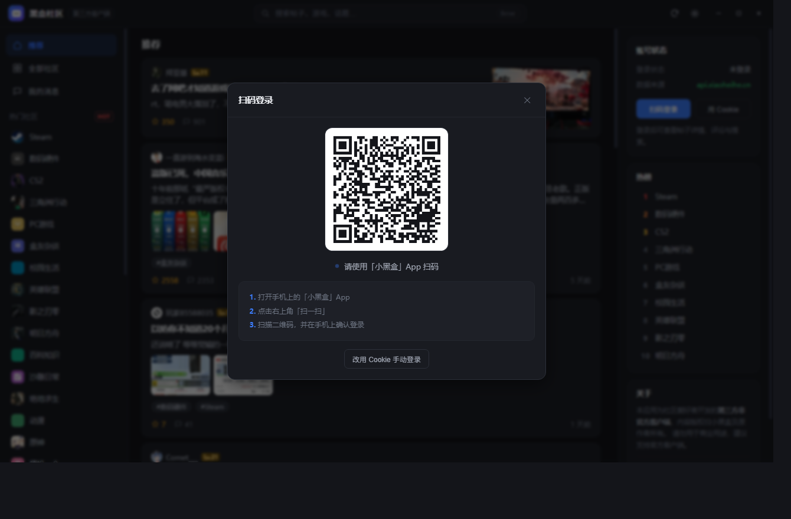

# 黑盒社区 · 第三方桌面客户端

基于 Electron 构建的小黑盒社区（xiaoheihe.cn）第三方桌面客户端，界面参考官方 Web 端信息流布局，数据全部来自小黑盒公开接口。

> ⚠️ 本项目为社区爱好者学习交流作品，**非官方应用**。所有内容版权归小黑盒及原作者所有，请勿用于商业用途。

---

## 功能

| 模块 | 说明 |
| --- | --- |
| 推荐信息流 | 无限滚动加载官方推荐流，展示作者/等级/配图/点赞/评论数 |
| 热门社区 | 侧栏 68 个热门板块一键切换 |
| 板块帖子 | 支持按板块浏览帖子列表 |
| **扫码登录** | 调用官方二维码接口，App 扫码即可登录，自动保存登录态 |
| 搜索 | 关键词搜索帖子（`search_type=link`）与话题，话题搜索免登录 |
| 帖子详情 | 正文（文本块拍平）+ 评论树（含楼中楼） |
| 我的消息 | 回复/点赞/系统通知（需登录） |
| Cookie 登录 | 扫码之外的备用方式，本机保存 |


---

## 接口现状（2026-11-23 实测）

这一节是本项目最需要维护的部分——上游接口会变，下面的结论都来自**当天真实请求**。

### 免登录可用 ✅

| 接口 | 说明 |
| --- | --- |
| `/bbs/app/feeds` | 推荐流。**每页固定 10 条，`limit` 参数无效**；`offset` 必须按实际返回条数累加 |
| `/bbs/app/topic/categories` | 板块分类，返回 `latest_hot_topics.children`（68 个）、`recommend_for_user_topics`（未登录为空）、`subscribed_topics`（未登录为空） |
| `/bbs/app/topic/feeds` | 板块帖子。每页约 20 条；`sort_type` 目前只返回「智能排序」，传 0/1/2 无差别 |
| `/bbs/app/topic/feeds/news` | 社区头条 |
| `/bbs/app/feeds/banner` | 首页 banner |
| `/bbs/app/api/search/topic` | 话题/游戏搜索，匿名稳定可用 |
| `/account/get_qrcode_url/`、`/account/qr_state/` | 扫码登录全流程 |
| `/bbs/app/user/message` | **注意**：未登录时也返回 `status=ok`，但 `messages` 为空、`message_unread_num=0`。必须自己判定，不能只看 `status` |

### 有强风控 / 需登录 🔐

| 接口 | 匿名表现 |
| --- | --- |
| `/bbs/app/link/tree`（详情+评论） | 绝大多数请求返回 `{"status":"show_captcha"}`；偶发返回 `status=ok` 但 `result` 为空。**实测用官方 Web 端页面在无痕浏览器里访问帖子页，同样被拦**，所以这不是本项目的参数问题 |
| `/bbs/app/api/general/search/v1`（帖子/用户搜索） | 一小段时间内可用，随后转为 `show_captcha` |
| `/account/restore_login` | `status=login`，`msg=请登录后使用该功能` |

### 已失效的接口 ❌

| 接口 | 现状 |
| --- | --- |
| `/bbs/app/api/general/search/v1/web` | 恒返回 `status=login`。**已改用 `/bbs/app/api/general/search/v1`** |
| `/bbs/app/topic/feeds/all` | 404，社区列表请用 `/bbs/app/topic/categories` |
| `/bbs/app/profile/user/profile` | 需要 `userid`，匿名无意义；资料请用 `/account/restore_login` |

### 风控处理策略

命中 `show_captcha` 后**按接口分组冷却 3 分钟**（`link` / `search` / `user` 三组互不影响），
避免持续重试延长风控时间。冷却期间 UI 会显示「触发了人机验证」并给出填入 Cookie 的入口，
而不是干巴巴地报错。**不做全局熔断**——详情被拦时推荐流和扫码登录仍然完全正常。

---

## 扫码登录原理

调用小黑盒官方 Web 端正在使用的二维码登录接口（无需逆向加密，直接复用公开流程）：

```
1. GET /account/get_qrcode_url/?app=web   -> { qr_url, expire: 120 }
   qr_url = https://api.xiaoheihe.cn/account/qr_login/?qr=<uuid>&app=web
   （已用 CDP 抓包核对：与官方网页版登录生成的 qr_url 完全一致）
2. 将 qr_url 生成为二维码图片展示（margin=4 保证静区，手机可稳定识别）
3. GET /account/qr_state/?qr=<uuid>&app=web -> result.error:
      wait   待扫码
      ready  已扫码，待手机确认
      ok     登录成功（返回 heybox_id / pkey / 用户资料）
      其他   已失效
4. 成功后按官方 e6e() 的口径组装 Cookie
   （heybox_id / user_heybox_id / pkey / user_pkey + 会话期间服务端下发的 Set-Cookie）并落盘
5. 立即调用 /account/restore_login 校验登录态并拉取资料，失败原因会显示在界面上
```

登录态轮询间隔 1.8s，二维码有效期 120s，过期后可一键刷新。网络抖动时自动重试（连续约 15 秒失败才提示）。



## 技术要点

- **请求签名**：小黑盒所有接口都要求 `hkey` 签名。本项目复现了 Web 端算法
  （字符集映射 → 交错混合 → MD5 → 前缀映射 + Rijndael 列混合校验位），
  仅依赖 Node 内置 `crypto`，**零第三方依赖**。
  已知测试向量：`/account/data_report_web/` + `1770529394` + `3D6891C5...` → `3XX1P62` ✅
  （服务端对 `_time` 有 ±5 秒以上容忍度，实测 `now-5` ~ `now+5` 全部通过）
- **安全隔离**：渲染进程 `contextIsolation` 开启、`nodeIntegration` 关闭，
  签名逻辑与 Cookie 全部留在主进程，页面通过受限 IPC 调用。
- **图片防盗链**：注册自定义 `hbimg://` 协议，在主进程带 `Referer` 拉取图片后回传，
  并做域名白名单（仅 `*.xiaoheihe.cn` / `*.max-c.com` / `*.akamai.steamstatic.com`）。
- **文本归一化**：帖子正文有两种形态（HTML 字符串 / 文本块数组的 JSON 串），
  评论是分组结构（`[{ comment: [...] }]`），统一在客户端拍平成渲染层可直接消费的形状。

## 目录结构

```
├── main.js              # Electron 主进程：窗口、IPC、图片代理、配置持久化
├── preload.js           # contextBridge 安全桥
├── server.js            # 浏览器预览模式的本地服务（复用同一套 API 封装）
├── src/
│   ├── hkey.js          # 请求签名算法
│   └── heybox.js        # 小黑盒 API 客户端（含风控冷却、文本/评论归一化）
├── renderer/
│   ├── index.html       # 界面骨架
│   ├── style.css        # 深色主题样式
│   ├── app.js           # 视图路由与渲染
│   └── shim.js          # 浏览器模式的 window.heybox 垫片
└── test/
    ├── client-test.js    # 接口链路 + 纯函数自检（匿名部分）
    ├── main-ipc-test.js  # 主进程 IPC 与 preload 一致性
    ├── qr-login-test.js  # 扫码登录回归
    ├── ui-check.js       # 无头 Edge 截图 + DOM 断言
    └── ui-flow.js        # 交互回归（滚动/切板块/搜索/详情/消息/扫码）
```

> 仓库根目录的 `apiclient.go` / `auth.go` / `qr.go` 是早期调研留下的接口参考片段，
> **不参与构建**（没有 `go.mod`，任何 JS 代码都不引用它们）。保留仅供对照上游行为。

## 下载

不想自己构建的话，直接用 GitHub Releases 里的打包产物：

| 文件 | 说明 |
| --- | --- |
| `Heybox-Desktop-Setup-1.1.0-win-x64.exe` | NSIS 安装包（78 MB），可选安装目录 |
| `Heybox-Desktop-1.1.0-win-x64-portable.zip` | 免安装绿色版（110 MB），解压后双击 `黑盒社区.exe` |

👉 [最新版本](https://github.com/rockyanyan/heybox-community-client/releases/latest)

> 未做代码签名，首次运行可能触发 Windows SmartScreen 提示：点「更多信息」→「仍要运行」。
> 仅提供 Windows x64 版本。

## 运行

```bash
npm install       # 安装依赖（首次会下载 Electron 运行时）
npm start         # 启动桌面应用
npm run dev       # 启动并打开开发者工具
npm run web       # 浏览器预览模式（无需 Electron，http://127.0.0.1:5173）
```

> 浏览器预览模式与桌面版共用同一套界面和 API 封装（`renderer/shim.js` 自动切换），
> 适合不装 Electron 快速预览 UI。桌面版功能以 `npm start` 为准。

## 测试

```bash
node test/client-test.js      # 真实接口链路 + 签名向量/文本归一化自检
node test/main-ipc-test.js    # 主进程与 preload（mock electron，但走真实网络）
node test/qr-login-test.js    # 扫码登录（创建/轮询/失效/Cookie 组装）
npm run web                   # 另开一个终端起预览服务
node test/ui-check.js         # 无头 Edge 截图，检查真实数据是否上屏
node test/ui-flow.js          # 交互回归：滚动分页、板块、搜索、详情、消息、二维码
```

没有可视化环境时 `ui-check.js` / `ui-flow.js` 也能跑（会自己拉起 headless Edge，
截图写到系统临时目录）。

### 验证打包产物

构建完成后可以对着**真实的 exe** 跑一遍（比只测浏览器模式更有说服力）：

```bash
# 1) 用调试端口启动打包版
./dist/win-unpacked/黑盒社区.exe --remote-debugging-port=9222

# 2) 连上去检查渲染、图片代理、滚动分页、扫码弹窗
node test/exe-check.js 9222
```

它会验证：页面确实从 `app.asar` 加载、preload 注入正常、图片走 `hbimg://` 且真实加载成功、
推荐流/侧栏/热榜有数据、滚动加载生效且无重复卡片、二维码弹窗可用、控制台无报错。

## 打包

```bash
npm run build     # 生成 Windows 安装包，输出到 dist/
```

产物：

| 文件 | 说明 |
| --- | --- |
| `dist/黑盒社区 Setup 1.0.0.exe` | NSIS 安装包（约 79 MB），可选安装目录 |
| `dist/win-unpacked/黑盒社区.exe` | 免安装绿色版，直接双击运行 |

打包注意事项（Windows）：
- `winCodeSign` 缓存解压含 macOS 符号链接，**无管理员权限/未开开发者模式时可能失败**。
  解决办法是预先手动解压跳过 `darwin`/`linux` 目录：
  ```bash
  node_modules/7zip-bin/win/x64/7za.exe x \
    "$LOCALAPPDATA/electron-builder/Cache/winCodeSign/<临时名>.7z" \
    -o"$LOCALAPPDATA/electron-builder/Cache/winCodeSign/winCodeSign-2.6.0" \
    -xr'!darwin' -xr'!linux'
  ```
- 国内网络建议设置镜像：
  ```bash
  export ELECTRON_MIRROR="https://npmmirror.com/mirrors/electron/"
  export ELECTRON_BUILDER_BINARIES_MIRROR="https://npmmirror.com/mirrors/electron-builder-binaries/"
  ```
- 未做代码签名，首次运行可能触发 Windows SmartScreen 提示，点「仍要运行」即可。

## 登录说明

未登录时：推荐流、板块帖子、社区列表、话题搜索可正常浏览；
帖子详情 / 评论 / 搜索 / 消息会返回 `show_captcha` 或 `login`。

解锁方式（二选一）：

1. **扫码**：点侧栏「扫码登录」，用小黑盒 App 扫一扫并确认。
2. **Cookie**：浏览器登录 [xiaoheihe.cn](https://xiaoheihe.cn) → F12 → Network →
   任选一个请求 → 复制请求头中的 `Cookie` → 应用右上角「设置」粘贴保存。
   > 如果匿名访问时已经触发过人机验证，建议先在同一浏览器里手动完成一次验证，再复制 Cookie。

Cookie 仅保存在本机 `userData/config.json`，不会上传到任何第三方。

## 已知限制

- 帖子详情与评论接口有较强风控，需有效登录 Cookie，且 Cookie 过期后需重新获取。
- 接口为逆向所得，官方变更后可能失效，届时需更新 `src/hkey.js` 中的签名逻辑。
- 点赞、评论、发帖等写操作未实现（只读浏览客户端）。
- 搜索在匿名状态下会被风控拦截，且拦截后需要等一段时间；这是上游行为，不是客户端 bug。
